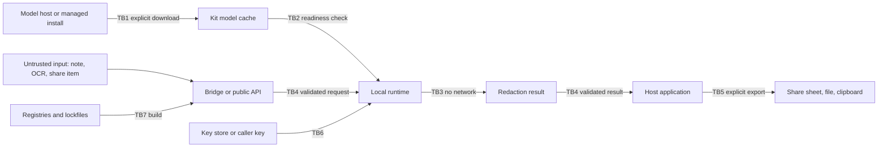

# OpenMedKit portable-kit threat model

Related models cover the [redactor](threat-model.md),
[clinical brief and local generation](clinical-brief-threat-model.md),
[Journey workflows](journey-threat-model.md), [MCP gateway](mcp-threat-model.md),
[agent boundaries](agent-threat-model.md) and
[multilingual ingestion](threat-model-multilingual-ingestion.md).

This page models the trust boundaries that the portable OpenMedKit runtimes add
on phones, in browsers and in desktop apps. Those runtimes take model bundles
by download, run inference inside another application's process, cross
JavaScript, Dart and Rust bridges into native code, and leave artifacts in
operating-system logs, caches, containers and backups. The other threat
models touch these runtimes only where a clinical brief passes through
OpenMedKit.

The portable-kit release was first planned as v3.5. It is now part of v4.0
under the [portable OpenMedKit workstream](https://github.com/maziyarpanahi/openmed/issues/3604),
so this page describes the v4.0 kits.

This is a design-level assessment of the repository, not a certification,
clinical validation or penetration test. Each control below is mapped to a
source path or test that exists on master, or to the open v4.0 issue that owns
it. Missing controls and residual risks are listed explicitly instead of being
assumed away. Known gaps are described at the threat-class level only. Report
a suspected bypass privately under the
[security disclosure policy](disclosure-policy.md), using synthetic data only.

## 1. Scope and method

### Supported surfaces

| Surface | Package | Process and trust boundary | Runtime guide |
| --- | --- | --- | --- |
| Swift | `swift/OpenMedKit`, root `Package.swift` | Library inside the host app on iOS, macOS, watchOS and visionOS; Core ML and MLX backends | [OpenMedKit (Swift)](../swift-openmedkit.md) |
| Extensions | `swift/OpenMedKit/Sources/OpenMedExtensionSupport`, `swift/OpenMedKit/Sources/ShareExtension`, `swift/OpenMedKit/Sources/ActionExtension` | Separate share or action extension process started by another app; bundled Core ML Nano model | [iOS share and action extensions](../runtimes/ios-share-extension.md) |
| Android | `android/openmedkit` | AAR inside the host app; ONNX Runtime, DJL tokenizer and ML Kit OCR | [Android integration](../android-integration.md) |
| Web | `js/openmedkit-web` | Page or bundler context; Transformers.js or ONNX Runtime Web on WebGPU or WASM | [ONNX Runtime Web loader](../runtimes/onnxruntime-web.md), [WebGPU runtime](../runtimes/webgpu.md) |
| React Native | `js/openmedkit-react-native` | JavaScript bundle calling native modules backed by the Swift and Android kits | `examples/react-native/RedactScreen.tsx` |
| Flutter | `js/openmedkit-flutter` | Dart calling a C library (`js/openmedkit-flutter/native/openmed_ffi.c`) over FFI, which calls the ONNX Runtime C API | `js/openmedkit-flutter/README.md` |
| Electron | `js/openmedkit-electron` | Renderer, preload bridge, main-process IPC handler and a utility process for inference | [Electron](../runtimes/electron.md) |
| Tauri | `js/openmedkit-tauri` | Webview, Rust command and a sidecar process over line-delimited stdio | `js/openmedkit-tauri/README.md`, `examples/tauri/redact-app.md` |

The demo apps (`swift/OpenMedScanDemo`, `android/OpenMedDemo`,
`android/OpenMedMapleDemo`, `android/OpenMedScanDemo`) are reference code. They
appear below only where they show a control or a gap that applications copy.

### Method

The model breaks each surface into assets, trust boundaries, data flows and
adversaries. Each abuse case in [section 6](#6-abuse-cases-and-controls) names
the surfaces and boundaries it crosses, the control that exists on master, the
open issue that owns the missing work, and the risk that remains after both.
The review was first-party and sequential. It should be repeated independently
before a production security sign-off, and refreshed whenever an owning issue
lands.

## 2. Assets

| Asset | What is protected | Loss condition |
| --- | --- | --- |
| **A1. Clinical input** | Note text, OCR text, transcripts, share-sheet and clipboard payloads, and span surface text | Input or span text reaches a log, error, cache, container, backup, crash report or network peer |
| **A2. Redaction result** | Redacted text, span offsets, labels, scores and hashes | Wrong offsets or labels leave part of an identifier, or a failed run is reported as a success |
| **A3. Model bundle** | Weights, tokenizer files, label maps, configuration and manifests | Substituted, downgraded or partially written files are loaded as a ready model |
| **A4. Runtime code** | ONNX Runtime native libraries and WASM, MLX and Core ML runtimes, the Flutter FFI library and the Tauri sidecar binary | Code from an unexpected source runs with access to A1 |
| **A5. Keys and salts** | HMAC keys and salts for hash replacement, and future bundle trust roots and policy keys | A key is guessable, public, exported, synced off device or reused across tenants |
| **A6. Device artifacts** | OS logs, console output, crash reports, caches, temporary files, app and shared containers, backups | Any of them holds A1 |
| **A7. Policy profiles** | Labels, thresholds, actions and merge rules shipped with each kit | Profiles drift between platforms so the same input is redacted differently |
| **A8. Build inputs** | Lockfiles, package registries, signing and publishing credentials | A dependency or build step introduces malicious, vulnerable, telemetry or incompatibly licensed code |

## 3. Trust boundaries

| ID | Boundary | Crossing | Default trust decision |
| --- | --- | --- | --- |
| **TB1** | Model acquisition | Hugging Face or another host, or a managed install, into the device | Remote bytes are untrusted until verified; inference never starts a download |
| **TB2** | Model and derived-file storage | Cache directories that other code, other processes, backups and sync can read or write | Cache content is re-validated before it is treated as ready |
| **TB3** | Inference runtime | Host app process, extension process, Electron utility process, Tauri sidecar, browser page or GPU | Inference stays on device with no network path for clinical text |
| **TB4** | Language bridge | React Native bridge, Flutter FFI, Electron IPC, Tauri command and sidecar stdio | Every argument and every result is validated on the receiving side |
| **TB5** | OS artifact | Logs, crash reports, share sheets, clipboard, containers and backups | Nothing from A1 crosses this boundary from kit code |
| **TB6** | Key store | Keychain, Secure Enclave, Android Keystore, or caller-held key bytes | Keys stay on device and are never logged or serialized |
| **TB7** | Build and distribution | SwiftPM, Maven, npm, crates.io and pub registries, plus the release workflows | Dependencies are locked, scanned and license-checked before release |



## 4. Data flows

### Model acquisition

- **Swift.** `OpenMedModelStore` in
  `swift/OpenMedKit/Sources/OpenMedKit/OpenMedModelStore.swift` downloads a
  manifest and the files it declares from a Hugging Face URL built from the
  repository and revision. Downloads happen only through explicit calls.
  `OpenMed` can also fetch tokenizer assets while loading a model when
  `allowNetworkAccess` is true (`swift/OpenMedKit/Sources/OpenMedKit/OpenMedKit.swift`).
  The speech product verifies a bundled artifact against pinned digests
  (`swift/OpenMedKit/Sources/OpenMedSpeech/VerifiedSpeechArtifact.swift`).
- **Extensions.** Use only a model bundled with the extension, loaded from file
  URLs (`swift/OpenMedKit/Sources/OpenMedExtensionSupport/ExtensionRedactionHandler.swift`).
- **Android.** `ModelDownloader` in
  `android/openmedkit/src/main/kotlin/com/openmed/openmedkit/download/ModelDownloader.kt`
  checks the repository listing against the catalog built into the AAR, then
  downloads into a staging directory and checks size and SHA-256 when the
  listing provides them. The library manifest
  (`android/openmedkit/src/main/AndroidManifest.xml`) requests no network
  permission; the host app decides.
- **Web.** `js/openmedkit-web/src/model-loader.ts` loads Hub IDs or local paths
  through Transformers.js. `js/openmedkit-web/src/runtime/ort-web-loader.ts`
  accepts only local model and WASM paths.
- **React Native and Flutter.** Receive a local model directory from the app.
  Flutter rejects remote schemes (`js/openmedkit-flutter/lib/openmedkit.dart`).
- **Electron and Tauri.** The main process or Rust setup configures the model
  path. Renderer code cannot choose it (`js/openmedkit-electron/src/main-service.ts`,
  `js/openmedkit-tauri/src-tauri/sidecar_command.rs`).

### Cache

- **Swift.** Uses
  `Caches/OpenMed/MLXModels/<repository>/<revision>` under the user's Caches
  directory, with a readiness marker that is re-checked against the manifest.
  Prepared tokenizer copies are stored in the same Caches root.
- **Android.** Stores ready models under `noBackupFilesDir` with ready metadata
  and LRU eviction
  (`android/openmedkit/src/main/kotlin/com/openmed/openmedkit/cache/ModelCache.kt`).
- **Web.** Session objects are cached in memory. Persistent model caching is
  whatever Transformers.js does by default.
- **Desktop.** Electron and Tauri expect the model directory to be provisioned
  before inference.

### Inference

All inference runs locally. Swift runs in the host app process, except the
extensions, which run in their own process. Android runs in the host app
process. The web package runs in the page context. Electron runs in a
utility process (`js/openmedkit-electron/src/utility-process.ts`). Tauri runs
in a sidecar process. React Native runs in the native module. Flutter runs in
the C library, inside the app process.

### Share and export

The kits return results to the caller and write no export file. Extensions
return redacted text to the host app as extension items
(`swift/OpenMedKit/Sources/OpenMedExtensionSupport/ExtensionItemCodec.swift`).
Saving, sharing and copying results is application code until native export
adapters exist.

### Logs and diagnostics

- **Swift.** Library sources contain no logging calls.
- **Android.** Diagnostics go through `SafeLog`
  (`android/openmedkit/src/main/kotlin/com/openmed/openmedkit/util/SafeLog.kt`).
  It has no sink by default and records labels, offsets and hashes only.
- **Electron.** Supplied loggers receive fixed event names.
- **Tauri.** The sidecar's stderr is discarded and errors map to fixed codes.
- **Web.** The package makes no console calls.

## 5. Adversaries

| ID | Adversary | Starting capability | Not assumed |
| --- | --- | --- | --- |
| **ADV-1** | Input author | Controls note, document, OCR or share-sheet content, including oversized, malformed or adversarial Unicode input | Code execution in the app |
| **ADV-2** | Network or mirror attacker | Controls or observes the path to a model host, or publishes a look-alike repository | Breaking TLS for a correctly configured client |
| **ADV-3** | Bundle supplier or cache writer | Supplies a model bundle, or writes to a cache or shared directory with less authority than the app | Replacing the signed app binary |
| **ADV-4** | Compromised script context | Runs script in an Electron renderer, a Tauri webview, a web page origin or a React Native bundle | Main-process, Rust host or native code execution |
| **ADV-5** | Device artifact reader | Reads backups, log collections, crash reports, a copied app container or the share-sheet history | Unlocking a protected keychain or keystore |
| **ADV-6** | Supply-chain attacker | Publishes a malicious or vulnerable version of a transitive dependency | Write access to this repository |
| **ADV-7** | Co-resident host app | Starts a share or action extension with crafted items and `userInfo` | Reading the extension's memory |

Out of scope: a jailbroken, rooted or otherwise compromised operating system,
physical memory extraction, malicious code in the host application itself, GPU
or timing side channels, and model recall quality. Model recall belongs to the
evaluation gates, not to this model.

## 6. Abuse cases and controls

Rows are abuse-case classes and controls, not confirmed findings. A row's
"Existing control" names code and tests on master. "Owner" is the open v4.0
issue that owns the missing control, listed in [section 7](#7-owning-issues).
"Residual risk" is what remains after both.

| ID | Surfaces | Boundary | Abuse case | Existing control on master | Owner | Residual risk |
| --- | --- | --- | --- | --- | --- | --- |
| K-01 | Swift, Android, Web, Extensions | TB1 | **Tampered or substituted model bundle.** A mirror, a compromised repository or a provisioning step serves weights, tokenizer files or label maps that differ from the published artifact. | Android checks per-file SHA-256 and size when the listing supplies them, and binds the commit and file list to the catalog hash (`android/openmedkit/src/main/kotlin/com/openmed/openmedkit/download/ModelDownloader.kt`; `rejectsChecksumFailuresWithoutMarkingTheModelReady` in `android/openmedkit/src/test/kotlin/com/openmed/openmedkit/download/ModelDownloaderTest.kt`). Swift speech assets are pinned by SHA-256 and size and checked again around load (`swift/OpenMedKit/Sources/OpenMedSpeech/VerifiedSpeechArtifact.swift`; `testHashVerifierRejectsChangedTruncatedAndSymlinkedContent` in `swift/OpenMedKit/Tests/OpenMedSpeechTests/SpeechArtifactTests.swift`). Extensions load only bundled file URLs. | #3640 | No kit authenticates a publisher. Swift MLX downloads and web model loads check no digest. Android files whose listing has no SHA-256 get only a size check, and no check at all when the size is also missing. |
| K-02 | Swift, Android, Web | TB1 | **Downgrade or floating revision.** A cached name points at a branch, so a later push or an attacker-chosen older revision silently changes the artifact. | Android binds the catalog hash to the commit SHA the listing returns. The Swift Maple artifact uses an exact commit pin (`swift/OpenMedKit/Sources/OpenMedKit/OpenMedMapleMLX.swift`), and the speech artifact uses digest pins (`VerifiedSpeechArtifact.swift`). | #3640, #3930, #3952 | Swift `OpenMedModelStore` defaults to `main` and keys its cache by the revision string. The Swift tokenizer download always resolves `main`. The web package has no default revision. Android fetches files by branch name when a caller passes one. No kit has rollback protection. |
| K-03 | Swift, Android, Extensions | TB1, TB2 | **Manifest path escape.** A manifest declares dot-segment, absolute, backslash or symlinked paths, so a download or a load reads or writes outside the model directory. | Swift `OpenMedMLXPathBoundary` (`swift/OpenMedKit/Sources/OpenMedKit/OpenMedModelStore.swift`) validates every component, refuses unsafe symlinks and checks again after each network wait (`testDownloadsRejectEveryUnsafeManifestPathBeforeArtifactRequests`, `testSymlinkEscapeAndDanglingLinksCannotMakeCacheReady`, `testDownloadRechecksSymlinkAfterResponseAndCleansItsPartialWrites` in `swift/OpenMedKit/Tests/OpenMedKitTests/OpenMedMLXTests.swift`). Android resolves downloaded names through a canonical-prefix check in `ModelDownloader.kt`. Extension assets refuse symlinks and wrong file types (`testNanoAssetConfigurationRejectsSymlinksAndWrongTypes` in `swift/OpenMedKit/Tests/ExtensionTests/ShareRedactionTests.swift`). | #3607, #3644 | The Android canonical-prefix check has no dedicated test. The Android `OpenMedModelStore` parity scaffold (`android/openmedkit/src/main/kotlin/com/openmed/openmedkit/OpenMedKit.kt`) builds directories from sanitized strings without a containment check. No check locks out a concurrent writer. |
| K-04 | Swift, React Native | TB1 | **Implicit network during tokenizer load.** Loading a model folder that lacks tokenizer files silently downloads unpinned tokenizer assets and reveals usage. | Extensions pass `allowNetworkAccess: false` and fail closed (`testLocalOnlyTokenizerLoadingFailsClosedWithoutAssets` in `ShareRedactionTests.swift`). Android loads its tokenizer only from the local model directory (`android/openmedkit/src/main/kotlin/com/openmed/openmedkit/Runtime.kt`). | #3930 | `allowNetworkAccess` defaults to `true` in `OpenMedKit.swift`. The React Native iOS module (`js/openmedkit-react-native/ios/OpenMedKitRN.swift`) and the zero-shot initializers cannot turn it off. |
| K-05 | Web, Electron, Tauri | TB1, TB3 | **Remote runtime or model fetch from a page.** A configuration value or injected script points the ONNX Runtime Web loader, a WASM asset path or a model variant at a CDN or another origin. | `assertOfflineAssetPath` in `js/openmedkit-web/src/runtime/ort-web-loader.ts` rejects URL schemes, protocol-relative paths and UNC paths for model and WASM assets (`tests/web/test_ort_web_loader.spec.ts`: "rejects remote model and wasm asset paths", "rejects UNC and remote-host file asset paths", "does not fetch when loading local offline assets"). The WebGPU session rejects remote model variants (`tests/web/test_webgpu_session.spec.ts`). Electron and Tauri load only host-configured paths (`tests/desktop/test_tauri_client.ts`: "renderer input cannot select a model path"). | #3952, #3954, #3710 | Hub IDs given to the Transformers.js path in `js/openmedkit-web/src/model-loader.ts` still allow remote fetches. There is no offline-only switch, no default revision and no subresource integrity. The offline-path check is a prefix and scheme test, and uncommon separator forms have no tests. |
| K-06 | Swift, Android | TB1 | **Network use without explicit consent.** A model fetch starts from an inference path or a background flow without the user knowing. | Android downloads only through an explicit `ModelDownloader.download` call, and its library manifest requests no internet permission (`libraryManifestDoesNotRequestInternetPermission` and `analyzeExtractAndDeidentifyOpenNoSockets` in `android/openmedkit/src/test/kotlin/com/openmed/openmedkit/util/NoNetworkInferenceTest.kt`). Swift model downloads happen only through explicit `OpenMedModelStore` calls; tokenizer fetches during a load are covered by K-04. | #3607, #3645 | No kit records a consent decision. The host app's network permission applies to every library in its process. Managed (MDM) import does not exist yet. |
| K-07 | Swift, Android, Web | TB2 | **Cache poisoning or partial promotion.** Another writer, a crash during download or a same-size substitution leaves files that are later treated as a ready model. | Swift writes each file atomically. It removes the ready marker and its partial files when a path check fails, and re-checks completeness before reporting ready (`testMissingDeclaredLabelMapCannotMarkCacheReady`, `testMLXModelCacheStateRecognizesPartialArtifact` in `OpenMedMLXTests.swift`). Android stages downloads, deletes the staging directory on failure, and requires matching hash strings and total size in its ready metadata (`android/openmedkit/src/main/kotlin/com/openmed/openmedkit/cache/ModelCache.kt`; `android/openmedkit/src/test/kotlin/com/openmed/openmedkit/cache/ModelCacheTest.kt`). | #3644 | Neither platform re-hashes files at the readiness check, so a same-size change after download goes undetected. Android removes the previous model before the new one is in place and does not sweep staging left by a killed process. Swift has no whole-snapshot swap. The kit does not integrity-check web caching. |
| K-08 | Swift, Android | TB2 | **Eviction or concurrency race.** Two loaders, two processes or an eviction pass act on one model directory while it is in use. | Android LRU eviction protects the model just stored, and is synchronized per `ModelCache` instance (`evictsLeastRecentlyUsedModelWhenBudgetIsExceeded` in `ModelCacheTest.kt`). | #3644, #3646, #3647 | Neither platform has a cross-process lock, and Swift has no eviction API. In-use leases and safe swap during inference are lifecycle work. |
| K-09 | Swift, Android, Extensions | TB2, TB5 | **Backup or sync capture of device files.** Device backup, cloud sync or a copied container captures caches, prepared tokenizer copies or derived files. | Android caches live under `noBackupFilesDir` (`ModelCache.kt`). The Maple demo disables backup and excludes every data domain (`android/OpenMedMapleDemo/app/src/main/AndroidManifest.xml`). Swift stores models and tokenizer copies under the user Caches directory, which iOS excludes from device backups. Extensions create no shared container or temporary file. | #3943 | Model caches are designed to hold no input. The risk is derived files that do. No kit sets a file-protection class. |
| K-10 | Swift, Android, Web | TB3 | **Unsupported-runtime abort.** A runtime starts where it cannot work (MLX on the iOS Simulator or an Intel Mac, native libraries on a 16 KB page-size Android device, WebGPU without an adapter), causing a crash, a hang or a silent switch to an unreviewed path. | `MLXTokenClassificationPipeline.isRuntimeSupported` in `swift/OpenMedKit/Sources/OpenMedKit/OpenMedMLXPipeline.swift` refuses the Simulator and non-arm64 hosts for token classification and zero-shot. Speech refuses unavailable accelerators (`testComputeNeverSilentlySubstitutesUnavailableAccelerator` in `SpeechArtifactTests.swift`). The web capability probe falls back from WebGPU to local WASM only, and throws when WASM is missing (`js/openmedkit-web/src/runtime/capability.ts`; `tests/web/test_webgpu_session.spec.ts`: "capability probe treats API exposure without an adapter as unavailable"). | #3949, #3927, #3641 | The Compass and Maple MLX runtimes have no Simulator guard. Android ships native libraries without a 16 KB alignment check. Each kit resolves capabilities differently. |
| K-11 | Swift, Android, Web, Electron, Tauri, Extensions | TB3 | **Cloud fallback for PHI.** A failed local load or a capability gap sends clinical text to a hosted model, a private-cloud model service or a remote runtime. | No kit contains a remote inference path or an Apple Foundation Models session. Electron runs inference in a utility process with offline environment variables, a request-cancelling session and a patched network stack (`js/openmedkit-electron/src/utility-process.ts`; `tests/web/test_electron_ipc.spec.ts`: "Electron IPC returns only renderer-safe spans matching the golden"). The Tauri sidecar starts with offline environment variables (`sidecar_command.rs`). Android inference opens no sockets under test (`NoNetworkInferenceTest.kt`). The extension source guard rejects networking APIs (`testExtensionHasNoNetworkCapabilityOrNetworkingAPIs` in `ShareRedactionTests.swift`). Swift streaming speech refuses engines that are not local (`testNonlocalEngineAndInvalidPCMRefuse` in `swift/OpenMedKit/Tests/OpenMedKitTests/StreamingSpeechTests.swift`). | none; repository policy in `AGENTS.md` | These are code properties and source guards, not a sandbox. The Swift library itself contains download code. The extension guard scans only the extension folders. A host app can add its own network path. Review must reject any cloud fallback for PHI. |
| K-12 | Web | TB3 | **Page-thread and GPU isolation.** Long inference blocks the page, a cancelled request keeps running, or GPU buffers outlive the request. Any script in the page origin has the same access to inputs as the kit. | Per-run GPU buffers are destroyed in `finally`, and `dispose()` releases weights (`js/openmedkit-web/src/runtime/webgpu-session.ts`). Input shapes and values are checked before upload. Threaded WASM is enabled only under cross-origin isolation (`capability.ts`). | #3718, #3954 | There is no worker facade, queue bound or `AbortSignal`. Device loss is not handled, and buffer sizes are not checked against device limits. The kit cannot defend against script that already runs in its origin; the Content-Security-Policy profile is the application's control. |
| K-13 | Extensions, Electron, Tauri, React Native, Android | TB3, TB4 | **Resource exhaustion.** Oversized text, many attachments or large PDFs exhaust memory or time, so that an operator turns the redactor off. | Extension input is capped at 16,384 characters and 64 KiB per item, eight items and 128 KiB per request, before inference (`ExtensionItemCodec.swift`; `testOversizedExtensionInputIsRejectedBeforeInference` in `ShareRedactionTests.swift`). Electron bounds text, pending work and time (`tests/web/test_electron_ipc.spec.ts`: "service bounds pending work and isolates logger failures", "timeout retires the worker and ignores its stale response"). Tauri bounds text and options and rejects concurrent calls (`sidecar_command.rs`). | #3646, #3647, #3648 | The React Native bridge does not bound text length. Android PDF page rendering (`android/openmedkit/src/main/kotlin/com/openmed/openmedkit/intake/PdfPageRenderer.kt`) has no page or size cap. Swift and Android do not handle memory pressure. |
| K-14 | Electron | TB4 | **IPC abuse from a compromised renderer.** Script in a renderer, for example through injected content, calls the de-identification channel with crafted or extra arguments, or from an untrusted frame. | One channel (`OPENMED_DEIDENTIFY_CHANNEL` in `js/openmedkit-electron/src/ipc.ts`) and a required sender check that fails closed. Requests must match the schema version, request ID format and length limits, and spans are projected to a renderer-safe shape (`tests/web/test_electron_ipc.spec.ts`: "Electron IPC rejects untrusted senders before inference", "renderer span validation rejects unsafe bounds and overlap", "renderer entrypoint contains no Node-only imports"). Errors are fixed codes. | #3711 | Frame-level sender checks and window hardening (`contextIsolation`, `nodeIntegration`, `sandbox`) are the application's job, documented in [Electron](../runtimes/electron.md) but not enforced by the package. Unknown request keys are not rejected. No packaged-app test harness exists. |
| K-15 | Tauri | TB4, TB7 | **Sidecar or command abuse.** Webview script picks a model path, calls other commands or floods the sidecar, or the sidecar binary is replaced on disk. | Three fixed operations, `deny_unknown_fields`, bounded text and options, a host-pinned model path, responses that must match the request ID and pass validation, and a process restart after IO, protocol or timeout errors (Rust unit tests in `js/openmedkit-tauri/src-tauri/sidecar_command.rs`; `tests/desktop/test_tauri_client.ts`: "malformed or overlapping span responses fail closed", "a sidecar killed mid-request becomes a clean host error"). | #3712 | The sidecar binary and the model are not digest-checked. No capability file ships, so the app must not grant shell spawn or stdin-write permissions to the webview (`examples/tauri/redact-app.md`). No workflow runs the Tauri client test or `cargo test`. |
| K-16 | React Native | TB4 | **Bridge argument injection or fail-open mapping.** JavaScript callers pass unbounded text, out-of-range thresholds, arbitrary metadata or any model path, or a native result with a missing field is mapped to success. | Blank model paths and empty hash keys are rejected before the native call (`tests/mobile/test_rn_bridge_parity.ts`: "empty hash keys are rejected before reaching native inference"). Spans match the native fixtures, and the bridge does not log input ("deidentify returns redacted text and never logs raw PHI"). | #3648, #3642, #3647, #3936 | Result mapping in `js/openmedkit-react-native/src/index.ts` does not fail closed for every missing native field, does not check span bounds, and forwards native error messages. The Android module (`js/openmedkit-react-native/android/OpenMedKitRnModule.kt`) keeps a coroutine scope that is never cancelled. Native modules are not yet packaged for autolinking. |
| K-17 | Flutter | TB4 | **FFI memory or encoding misuse.** Dart passes malformed text, a non-finite threshold, a large label map or mismatched lengths across the C boundary, or native error text reaches Dart exceptions. | The C library rejects null and empty inputs, checks logits dimensions and token offsets, and owns the strings it returns, which callers free with `openmed_span_list_free` and `openmed_string_free` (`js/openmedkit-flutter/native/openmed_ffi.c`, `js/openmedkit-flutter/native/openmed_ffi.h`). Dart rejects remote model directories, NUL text and out-of-range offsets before marshalling, and frees native buffers in `finally` (`openmedkit.dart`; `tests/mobile/test_flutter_ffi.dart`). The test session is compiled in only when explicitly enabled. | #3709 | The C boundary does not validate UTF-8, non-finite thresholds or size arithmetic. Dart validation errors and native `lastError` text are not value-free. No sanitizer build runs. |
| K-18 | Swift, Android, Flutter, React Native | TB5 | **PHI in errors and descriptions.** An error case or a `description` carries a token, span text or input that reaches a crash report, a UI alert or the host app's own diagnostics. | Android `EntityPrediction.toString` prints a hash and offsets (`descriptionContainsHashInsteadOfRawSpanText` in `android/openmedkit/src/test/kotlin/com/openmed/openmedkit/EntityPredictionTest.kt`). Many Swift multimodal, speech and governance types use redacted descriptions (`testProtectedDescriptionsAndTimingValidation` in `StreamingSpeechTests.swift`; `testDescriptionsExcludeOpaqueMetadataAndRejectedValues` in `swift/OpenMedKit/Tests/OpenMedKitTests/AgentGovernanceTests.swift`). Electron, Tauri and web alignment errors use fixed codes or fixed messages (`tests/web/test_npm_deidentify.spec.ts`: "unalignable classified tokens fail without exposing source text"). | #3942, #3943, #3709 | Swift `OpenMedPrivacyFilterError.unknownToken` (`swift/OpenMedKit/Sources/OpenMedKit/OpenMedPrivacyFilterPipeline.swift`) and `EntityPrediction.description` (`swift/OpenMedKit/Sources/OpenMedKit/EntityPrediction.swift`) carry input text. Several Android data classes use the default `toString`. Flutter and React Native forward error text. |
| K-19 | Swift, Android, Web, Electron | TB5 | **PHI in OS logs and console.** Library code writes inputs or spans to the unified log, logcat or the console, where log collectors, sysdiagnoses or other tools can read them. | Swift library sources contain no logging calls. Android sends diagnostics through `SafeLog`, which has no sink by default and records labels, offsets and hashes only. A source guard rejects direct logging (`productionKotlinSourcesDoNotBypassSafeLog` and `inferenceDiagnosticsContainHashesAndOffsetsButNoPlaintextIdentifiers` in `android/openmedkit/src/test/kotlin/com/openmed/openmedkit/util/NoPhiLoggingTest.kt`). The web package makes no console calls. Electron loggers receive fixed event names only. | #3943 | The Android source guard covers the library module only, not the React Native or Flutter plugin code. Swift has no source guard. Demo apps are not covered: the Swift scan demo logs error descriptions as public log values (`swift/OpenMedScanDemo/OpenMedScanDemo/ViewModel/ScanFlowViewModel.swift`). |
| K-20 | Swift, Android, Extensions | TB2, TB5 | **PHI in containers and temporary files.** Derived files, prepared copies or state left after a crash keep PHI in the app container, a shared container or a temporary directory. | The kits keep inputs and results in memory. The extension writes no files and releases its runtime after every request (`testRuntimeCleanupRunsAfterSuccessAndFailure` in `ShareRedactionTests.swift`). Android model metadata stays free of model content (`keepsLogsAndMetadataFreeOfModelContent` in `ModelDownloaderTest.kt`). | #3943, #3644 | No sweep shows that planted sentinels are absent after a run, on either platform. Prepared tokenizer copies and orphaned download staging are not cleaned up on every path; they hold model files, not inputs. |
| K-21 | Extensions | TB4, TB5 | **Hostile share or action input.** A host app sends oversized, non-text or numerous items, a remote model URL, or an unexpected policy name in `userInfo`. | The item codec accepts plain text only and bounds each item and each request. Remote model URLs are rejected, the action's policy name must be a bundled profile, and invalid runtime output fails closed (`testRemoteModelAssetsAreRejectedBeforeLoading`, `testUTF8AndBatchBudgetsCannotBeBypassedByGraphemeClustering`, `testInvalidRuntimeOutputFailsClosed`, `testPolicyPickerUsesEveryBundledProfile` in `ShareRedactionTests.swift`). | #3720, #3716 | The UIKit controllers have no automated test, and no CI job runs iOS tests. The application owns the extension targets, `Info.plist` and entitlements. After an error, the input stays visible in the share sheet until it is dismissed. |
| K-22 | Swift, Android, Web, Electron, Tauri | TB5 | **Export through a share sheet, the clipboard or a file.** A redacted result with leftover identifiers is exported, or the unredacted original is exported by mistake. | The kits return results to the caller and export nothing themselves. The Swift clinical brief audit view leaves out the summary (`auditJSON` in `swift/OpenMedKit/Sources/OpenMedKit/ClinicalBrief.swift`). | #3720 | There are no native share or save adapters for verified sanitized artifacts; every export is application code. The Swift result type keeps the original text for the caller (`swift/OpenMedKit/Sources/OpenMedKit/DeidentificationResult.swift`). |
| K-23 | Swift, Android, Web, React Native | TB6 | **Weak or default hash keys.** Hash replacement uses a public default salt or an unkeyed digest, so someone with a candidate list can link or confirm identifiers. | The web package keys span hashes with a fresh random 32-byte HMAC key per call by default (`js/openmedkit-web/src/index.ts`; `tests/web/test_npm_deidentify.spec.ts`: "default span hashes are private per call and consistent within it"). React Native generates a random key per call when none is supplied and rejects empty keys. Android `deid.DeidentifyEngine` computes HMAC-SHA256 with a caller-supplied salt (`android/openmedkit/src/main/kotlin/com/openmed/openmedkit/deid/DeidentifyEngine.kt`; `hashUsesStableSaltedDigestWithoutPlaintext` in `android/openmedkit/src/test/kotlin/com/openmed/openmedkit/deid/DeidentifyEngineTest.kt`). | #3714, #3715 | The Android salt defaults to a public constant. The Android facade and the Swift `.hash` replacement use unkeyed SHA-256. No bundled policy uses hashing today. Caller-supplied keys live in process memory as plain bytes. |
| K-24 | Swift, Android | TB6 | **Key-store misuse.** Once platform key stores are adopted, a key is exportable, synced to a cloud keychain, usable while the device is locked, or claimed as hardware-backed without evidence. | No control yet: the kits contain no Keychain, Secure Enclave, Android Keystore or encrypted-preferences code. | #3714, #3715, #3716 | The adapters must use device-only keys that cannot be exported. They must not claim Secure Enclave or StrongBox protection without real-device evidence. |
| K-25 | All | TB7 | **Dependency substitution or vulnerable dependency.** A registry, a mirror or a compromised maintainer ships a malicious or vulnerable transitive dependency into a kit build. | npm lockfiles exist for the web, Electron, Tauri and React Native packages, and `js/openmedkit-tauri/src-tauri/Cargo.lock` locks the Rust side. The root `Package.resolved` pins SwiftPM. `npm audit` gates the web package publish, which runs with `--ignore-scripts --provenance` (`.github/workflows/publish.yml`). The Gradle wrapper distribution is checksum-pinned (`android/gradle/wrapper/gradle-wrapper.properties`). | #3951, #3929 | Android has no dependency locks or verification metadata, and Flutter has no committed `pubspec.lock`. Dependabot covers pip, GitHub Actions and pre-commit only (`.github/dependabot.yml`), and vulnerability scanning covers `uv.lock` only (`.github/workflows/vuln-scan.yml`). The root and nested Swift manifests pin different MLX versions. |
| K-26 | All | TB7 | **License contamination.** A kit dependency, a bundled model or a tokenizer carries a license that does not allow redistribution, such as GPL, source-available terms or restricted vocabularies. | Python dependency license gate and inventory (`scripts/release/check_license_policy.py`, `scripts/licenses/inventory.py`, [dependency license inventory](license-inventory.md)). | #3937, #3944 | No offline license gate parses SwiftPM, Gradle, npm, Cargo or pub manifests yet. Model and tokenizer redistribution boundaries are not documented per kit. |
| K-27 | All | TB3, TB7 | **Telemetry from dependencies.** A new dependency adds analytics, crash reporting or update checks that send usage or content off the device. | No analytics or crash-reporting SDK appears in the kit manifests (`Package.swift`, `android/gradle/libs.versions.toml`, `js/openmedkit-web/package.json`, `js/openmedkit-flutter/pubspec.yaml`). The [no-telemetry guarantee](no-telemetry.md) is enforced for the Python package. | none (unowned) | No automated gate checks the kit manifests. The #3937 manifest parsers are the natural place for a deny-list. |
| K-28 | Swift, Android, Web, Electron, Tauri, Flutter, React Native | TB4 | **Offset-unit confusion across a bridge.** One side counts UTF-16 units and the other counts Unicode scalars, so a redaction lands on the wrong characters and leaves part of an identifier. | Swift and Android share an offset contract fixture (`swift/OpenMedKit/Tests/OpenMedKitTests/OffsetContractParityTests.swift`; `scalarAndUtf16ConversionsRejectSurrogatePairSplits` in `android/openmedkit/src/test/kotlin/com/openmed/openmedkit/parity/OffsetContractParityTest.kt`). Tauri documents and tests code-point offsets (`tests/desktop/test_tauri_client.ts`: "span offsets use the documented Unicode code-point coordinate space"). The web aligner handles supplementary letters (`tests/web/test_npm_deidentify.spec.ts`: "alignment preserves decomposed accents and supplementary Unicode letters"). | #3642, #3608, #3643 | Web and Electron return UTF-16 offsets, Tauri and Flutter return code points, and React Native does not check offsets. Policy profiles also differ by platform. |
| K-29 | Swift, Android, Web | TB1, TB2 | **Managed import or offline web install.** A managed bundle or a service-worker cache installs, or keeps, a stale, revoked or substituted bundle. | Not implemented on master. The browser tests block service workers (`tests/browser/brand/playwright.config.ts`). | #3645, #3710, #3640, #3644 | Until that work lands, no supported surface installs bundles through MDM or a service worker. Applications that build their own must apply the same verification. |

## 7. Owning issues

Every issue named in the abuse-case table is open in the v4.0 milestone.

| Issue | Control it owns |
| --- | --- |
| [#3607](https://github.com/maziyarpanahi/openmed/issues/3607) | Android format-aware artifact acquisition with explicit network consent, replacing the MLX-shaped scaffold store |
| [#3608](https://github.com/maziyarpanahi/openmed/issues/3608) | Swift span equivalence against the shared Swift-Kotlin golden fixture |
| [#3640](https://github.com/maziyarpanahi/openmed/issues/3640) | One signed portable bundle manifest: content identity, signature envelope and verifiers for every kit |
| [#3641](https://github.com/maziyarpanahi/openmed/issues/3641) | Consistent capability resolution and fallback plans |
| [#3642](https://github.com/maziyarpanahi/openmed/issues/3642) | Unicode offset, label, action and serialization gate across surfaces |
| [#3643](https://github.com/maziyarpanahi/openmed/issues/3643) | Equivalent policy profiles, thresholds, merging and surrogates |
| [#3644](https://github.com/maziyarpanahi/openmed/issues/3644) | Atomic, resumable, integrity-checked and eviction-safe caches |
| [#3645](https://github.com/maziyarpanahi/openmed/issues/3645) | Managed offline bundle import on mobile |
| [#3646](https://github.com/maziyarpanahi/openmed/issues/3646) | Swift cancellation, background and memory-pressure safety |
| [#3647](https://github.com/maziyarpanahi/openmed/issues/3647) | Android lifecycle, coroutine and memory-pressure safety |
| [#3648](https://github.com/maziyarpanahi/openmed/issues/3648) | React Native bridge parity on real native models |
| [#3709](https://github.com/maziyarpanahi/openmed/issues/3709) | Flutter FFI parity and lifecycle with portable bundles |
| [#3710](https://github.com/maziyarpanahi/openmed/issues/3710) | Installable browser inference with a safe offline asset lifecycle |
| [#3711](https://github.com/maziyarpanahi/openmed/issues/3711) | Packaged Electron qualification |
| [#3712](https://github.com/maziyarpanahi/openmed/issues/3712) | Packaged Tauri sidecar qualification, including binary and model digests |
| [#3714](https://github.com/maziyarpanahi/openmed/issues/3714) | Apple Keychain adapters for policy and bundle trust secrets |
| [#3715](https://github.com/maziyarpanahi/openmed/issues/3715) | Android Keystore adapters for policy and bundle trust secrets |
| [#3716](https://github.com/maziyarpanahi/openmed/issues/3716) | Real-device qualification harness |
| [#3718](https://github.com/maziyarpanahi/openmed/issues/3718) | Cancellable browser workers with bounded queues |
| [#3720](https://github.com/maziyarpanahi/openmed/issues/3720) | Native export of verified redactions through explicit share actions |
| [#3927](https://github.com/maziyarpanahi/openmed/issues/3927) | Android native libraries on 16 KB page-size devices |
| [#3929](https://github.com/maziyarpanahi/openmed/issues/3929) | Aligned root and nested Swift package manifests |
| [#3930](https://github.com/maziyarpanahi/openmed/issues/3930) | Offline Swift tokenizer loading by default, failing closed when assets are absent |
| [#3936](https://github.com/maziyarpanahi/openmed/issues/3936) | React Native bridge registration and packaging for autolinking |
| [#3937](https://github.com/maziyarpanahi/openmed/issues/3937) | Offline license gate for Swift, Android and JavaScript dependencies |
| [#3942](https://github.com/maziyarpanahi/openmed/issues/3942) | Value-free Swift errors with sentinel tests |
| [#3943](https://github.com/maziyarpanahi/openmed/issues/3943) | Container and log sweep for PHI sentinels after on-device runs |
| [#3944](https://github.com/maziyarpanahi/openmed/issues/3944) | Export toolchain, artifact license and redistribution documentation |
| [#3949](https://github.com/maziyarpanahi/openmed/issues/3949) | iOS Simulator MLX boundary and Simulator test runs |
| [#3951](https://github.com/maziyarpanahi/openmed/issues/3951) | Android dependency locks and vulnerability scanning of every kit lockfile |
| [#3952](https://github.com/maziyarpanahi/openmed/issues/3952) | Pinned default web model revision and an offline-only mode |
| [#3954](https://github.com/maziyarpanahi/openmed/issues/3954) | Content-Security-Policy profile for browser inference |

## 8. Unowned controls and residual risks

### Controls without an owning issue

At the time of writing, no open v4.0 issue explicitly owns these controls. The
nearest candidate is named so the release gate can track them.

- **A deny-list gate for telemetry and crash-reporting dependencies in kit
  manifests** (K-27). Nearest: #3937.
- **Value-free Flutter and React Native errors, and fail-closed React Native
  result mapping** (K-16, K-17, K-18). The Swift side belongs to #3942.
  Nearest for the bridges: #3709 and #3648.
- **A CI lane for the Tauri client test and the Rust sidecar tests** (K-15).
  Nearest: #3712.
- **Enforced Electron window hardening**, rather than documented hardening
  (K-14). Nearest: #3711.
- **A file-protection class for Swift and Android files that may hold derived
  data** (K-09). #3943 detects leftovers but does not set protection.

### Residual risks after every owner lands

- The host application is trusted. A kit cannot stop app code, an app
  extension that shares its process, or an injected script in its origin from
  reading inputs or results.
- The operating system is trusted. Rooted and jailbroken devices, OS log
  collection outside kit code, and forensic memory capture are not defended.
- Signatures will establish integrity and publisher identity, not model
  quality or recall. Recall and leakage remain evaluation gates.
- Hash replacement keyed by a device key still lets anyone who holds the key
  link repeated identifiers.
- Source guards and offline flags are not sandboxes. Native dependencies can
  open sockets that a JavaScript or Kotlin guard does not see.
- Browser GPU memory isolation is the browser's responsibility. The kit
  destroys per-run buffers but cannot prove they were cleared.

## 9. Unsupported deployments

These deployments are unsupported. Abuse cases that only arise in them are out
of scope:

- MLX inference on the iOS Simulator or on Intel Macs. Use Core ML there; see
  [Apple platforms](../runtimes/apple-platforms.md).
- Android OpenMedKit on 16 KB page-size devices until #3927 lands.
- Loading model or WASM assets from a remote origin through the ONNX Runtime
  Web loader, which rejects them.
- Any cloud, hosted or private-cloud model fallback for PHI workflows,
  including Apple Foundation Models paths that are not on device.
- Electron renderers created with `nodeIntegration` enabled or
  `contextIsolation` disabled, and Tauri webviews granted shell spawn or
  stdin-write permissions.
- React Native apps that load the bridge without the packaged native modules,
  until #3936 lands.
- Flutter web, which has no FFI.
- Extensions that request a network entitlement or an App Group shared
  container for clinical input.
- Production use of the demo apps.

These threats are out of scope for this page:

- Clinical-brief generation threats. They stay with the v3.0 release scope
  ([#3233](https://github.com/maziyarpanahi/openmed/issues/3233)) and the
  [clinical brief threat model](clinical-brief-threat-model.md).
- The REST, gRPC and MCP services. See the [MCP gateway](mcp-threat-model.md)
  and [Journey](journey-threat-model.md) models.
- The browser extension in `web/extension` and the static website demos.
- Model recall, calibration and multilingual quality.
- Publishing credentials and release provenance. See
  [trusted publishing](../release/trusted-publishing.md) and
  [supply-chain controls](supply-chain.md).

## 10. Severity calibration

Apply the repository
[security policy](https://github.com/maziyarpanahi/openmed/blob/master/SECURITY.md#severity).
A privacy-impacting defect is never rated below **High**. The examples below
are hypothetical triage outcomes, not findings.

| Severity | Portable-kit example if independently established |
| --- | --- |
| Critical | Real PHI leaves the device through a kit path, or a substituted bundle is accepted as verified once signing exists |
| High | Input text in a kit-written log, error or container file; a renderer or webview reaching inference without the sender or argument checks; a default key that lets hashes be reversed by lookup |
| Medium | A resource-exhaustion path that disables redaction without exposing data; an unsupported runtime that crashes instead of refusing |
| Low | A hardening gap with no demonstrated exposure, such as missing CI for a test that already passes locally |

## 11. Keeping this model current

`tests/unit/test_openmedkit_threat_model_docs.py` checks this page offline.
It verifies that every repository path quoted on the page exists, that every
supported surface and trust boundary has at least one abuse case, that every
abuse case names a control path or an owning issue as well as a residual risk,
that every owning issue appears in [section 7](#7-owning-issues), and that the
page contains no private paths or credential-shaped strings.

```bash
.venv/bin/python -m pytest tests/unit/test_openmedkit_threat_model_docs.py -q
```

When an owning issue lands, move its control into the "Existing control"
column and narrow the residual risk in the same pull request.
